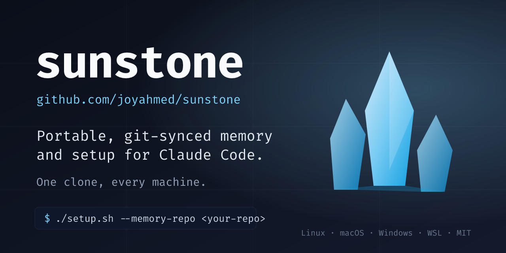

<div align="center">

# sunstone

**Your agent's memory is a git repo you own.**<br>
Carry it to a new machine, run one installer, and everything you taught it is back.

[](#install) [](#what-it-is) [](LICENSE)

Free · No server, no account, no database · Shell + Node + git

<br>



</div>

<br>

## Why I built this

I code on more than one machine. Every time, my coding agent started from zero on the new one. What it had learned about me and my projects sat in a folder on the old machine, and it never moved. If that machine died, the memory died with it.

I didn't want a service or a database for this. I already had the right tool: git. So **sunstone** keeps the memory in a private git repo that belongs to you. Each session pulls it at the start and commits what it learned at the end. A new machine is one clone and one installer away from knowing everything the old one knew.

It's the framework only, with nothing personal in it. Your memory, and any skills or commands of your own, live in your own repo.

> *A sunstone is the crystal Jor-El used to keep Kryptonian knowledge alive after the planet was gone. Plant it, and the whole Fortress of Solitude grows back.*

## What it is

Two repos, kept apart on purpose:

| Repo | What it holds | Who owns it |
|---|---|---|
| **sunstone** (this one) | The installers, the hooks, `memory-doctor`, the docs. Nothing personal. | Public, shared |
| **your memory repo** | Your memory files, an optional `sunstone.conf`, and, if you want, your own skills, commands, agents, hooks and status line in the same layout. | You, private |

The installer copies hooks into Claude Code's settings. From then on, every session starts by pulling your memory repo and putting one file from it into the conversation, and ends by committing what was written to the memory folder.

## Highlights

- 🧠 **Memory that travels**: a private git repo you own. The installer records where it is cloned and assumes nothing else about it.
- 🔄 **Sync on its own**: pull and inject at session start, commit at session end, push at the next start.
- 🩺 **`memory-doctor`**: one read-only check of the wiring, the sync state, the memory index, duplicates and drift. Exit code 1 on an error, so it works as a gate.
- 🛡️ **Git guards**: refuse a commit that mixes memory files with other files, and any force-push to a guarded repo. Your repos' own git hooks still run.
- 🔐 **Secret guards**: stop a session from reading a `.env` or SSH key into the chat, and from writing a live key into a file.
- 📏 **Context cap**: a session gets a nudge as it fills up and a hard stop at 80k tokens grown, so it hands over before it gets sloppy.
- 🧩 **Bring your own**: a skill, command, agent or hook in your memory repo with the same name as one here wins.

<details>
<summary><b>Everything it installs</b> (click to open)</summary>

### Memory

- `ai-memory-sync` (session start): pulls your memory repo, pushes anything not yet pushed, runs the repo's optional `claude-setup/session-start.d/` scripts, then injects your memory file. Every network call is time-bounded.
- `ai-memory-commit` (session end): commits what changed under the memory folder, staged by path and nothing else, then pushes in the background.
- `memory-doctor-notice` (session start): a short notice from `memory-doctor`, at most once every 20 hours, and nothing when everything is clean.
- A session bus (off until you set `BUS_DIR`): one machine leaves a note in its own outbox file, and the next session on another machine is told about it.

### Guards

- `pre-commit` and `pre-push`, installed through a global `core.hooksPath`. They chain to each repo's own `.git/hooks/`, so husky and friends keep working.
- `public-privacy-guard`: refuses to commit personal content into a public repo.
- `guard-secrets` and `guard-key-literals`: keep secrets out of the transcript and out of files.
- `context-guard`, `context-cap` and `token-budget`: watch how full a session is and how much its agents spend.

### Agents and commands

- Five agent files (`architect`, `verify`, `general-purpose`, `implementer`, `scout`), each pinned to a model tier, so a delegated job runs on a model picked for it.
- `/supercode` (fan the work out over parallel agents), `/supermode` (plan once, then run unattended), and `/mute`, `/unmute`, `/solo`, `/unsolo`, `/sound` for spoken notices.

### Settings

- A `~/.claude/CLAUDE.md` with the rules for where a memory goes. A copy in your memory repo wins.
- A merge into `~/.claude/settings.json` that registers the hooks.
- Re-running the installer is how an update lands, and `setup.sh` backs up anything it overwrites.

The file-by-file list, the flags and the uninstall steps are in [claude-setup/SETUP.md](claude-setup/SETUP.md).

</details>

## Install

You need `git` and Claude Code. `node` and `python3` are recommended; on Windows `node` is required. You also need a memory repo: any **private** git repo you can push to. An empty one is fine. [How to make one](claude-setup/SETUP.md#the-memory-repo).

**Linux, macOS and WSL**

```bash
git clone https://github.com/joyahmed/sunstone sunstone
cd sunstone
./setup.sh --memory-repo git@github.com:you/my-memory.git
```

**Windows** (use `pwsh`, PowerShell 7 - `setup.ps1` does not run under the built-in Windows PowerShell 5.1)

```powershell
git clone https://github.com/joyahmed/sunstone sunstone
cd sunstone
pwsh -ExecutionPolicy Bypass -File setup.ps1 -MemoryRepo git@github.com:you/my-memory.git
```

Then restart Claude Code and check it:

```bash
node claude-setup/scripts/memory-doctor.js
```

A git URL is cloned into `~/.ai-memory` (or `--clone-to <dir>`); a local path is used where it is. Use the URL form this machine can already log in with. If the clone fails, `setup.sh` stops before it writes anything.

To update later: `cd sunstone && git pull && ./setup.sh`. A `git pull` alone changes nothing that runs, because the hooks run from copies.

## Watch it

More of what I build: [youtube.com/@joysbuilds](https://www.youtube.com/@joysbuilds).

## Learn more

- [claude-setup/SETUP.md](claude-setup/SETUP.md): the full runbook. Flags, the memory repo layout, the `sunstone.conf` keys, what lands where, Windows notes, troubleshooting, uninstall.
- `node claude-setup/scripts/memory-doctor.js --verbose` lists every check it makes.

## License

MIT. See [LICENSE](LICENSE).

---

<div align="center">

I build tools I use myself, from Bangladesh. If sunstone saves you from teaching a new machine everything again, that makes me happy.<br>
Found a bug or want something? [Open an issue](https://github.com/joyahmed/sunstone/issues).

**Joy**

</div>
